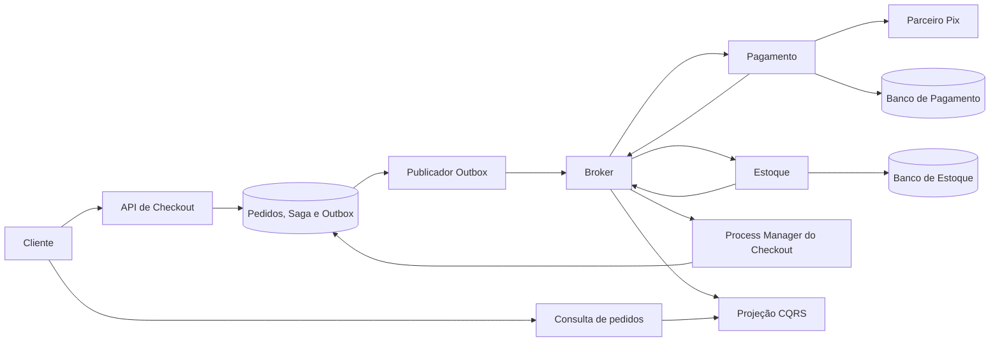

# Projeto Final — PE-JV-003

**Autor:** Douglas Gomes

**Turma:** 1753

**Entrega:** cinco documentos de System Design das aulas 02 a 06.

Este repositório reúne as decisões para um Checkout de marketplace: API de pagamentos resiliente, banco sob concorrência, Saga com compensação, deploy compatível entre versões e diagnóstico em produção. O trabalho final solicitado é documental; trechos Java/SQL, diagramas e planos de teste ilustram o desenho e não constituem uma aplicação executável.

## Documentos por aula

| Aula | Tema e documento | Decisões principais |
|---|---|---|
| 02 | [APIs Resilientes](APIs-Resilientes.md) | MVC com threads virtuais, limites de recursos, breaker, deadline, idempotência e três cenários de falha. |
| 03 | [Banco de Dados em Larga Escala](Banco-de-Dados-Larga-Escala.md) | PostgreSQL como fonte de verdade, UUIDv7, locks, diagnóstico e índices orientados a medições. |
| 04 | [Microsserviços e Padrão Saga](System-Design-Microsserviços-Padrão-Saga.md) | Orquestração durável, estorno confirmado, Outbox/Inbox, reconciliação e CQRS. |
| 05 | [Containers, CI/CD e Deploy sem Downtime](CD-Deploy-Downtime.md) | Imagem imutável, canary, expand/migrate/contract e rollback preservando dados. |
| 06 | [Observabilidade e Diagnóstico em Produção](Observabilidade-Diagnóstico-PRD.md) | RED/USE, correlação, privacidade, tail sampling e diagnóstico sem shell/SSH. |

Os nomes de arquivo usados nas aulas foram preservados; há um documento próprio para cada aula. As seções das aulas 02, 05 e 06 correspondem aos templates disponíveis. As aulas 03 e 04 preservam e complementam as respostas já existentes neste repositório; seus templates originais não estavam entre os materiais locais encontrados.

## Cenário e coerência das decisões

A aula 02 exige **10.000 usuários simultâneos**. As aulas seguintes tratam de **5.000 TPS de checkout** e consultas em grande volume. Concorrência e taxa de chegada são grandezas distintas: não se presume que uma comprove a outra.

O diagrama simplifica a mensageria: cada serviço persiste suas alterações e eventos em transação local com Outbox; consumidores deduplicam com Inbox. Os bancos dos serviços são autônomos; apenas as réplicas do mesmo serviço compartilham seu banco. O Process Manager pertence ao Checkout e persiste transições, sem acessar bancos de Pagamento/Estoque.

No caso de Pix aprovado antes de estoque rejeitado, o pedido só termina cancelado depois da confirmação do estorno. Timeout gera estado incerto e reconciliação, nunca autorização para cobrar novamente sem verificar. Consultas podem atrasar por consistência eventual, mas não alteram a verdade financeira.

As releases preservam schema, eventos e estados compreendidos pela versão anterior durante a janela de rollback. Telemetria correlaciona HTTP e mensagens e distingue aceite de conclusão. PostgreSQL, broker, bibliotecas e limites apresentados são escolhas de desenho, não exigências adicionais do enunciado.

## Validação e entrega

Cada aula inclui justificativas, riscos e estratégia de testes. Os valores de timeout, retenção, limiares de canary e metas de diagnóstico são propostas iniciais. Não foram executados testes de uma aplicação Java, carga de 5.000 TPS ou infraestrutura: não existe implementação desses componentes neste repositório. A revisão documental verifica cobertura das seções, ausência de campos de resposta pendentes, links internos e exemplos formatados.