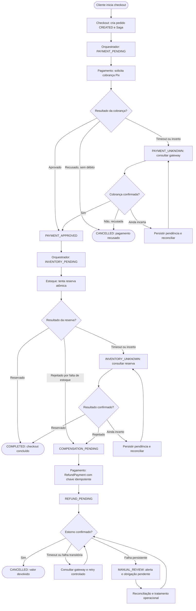

# Aula 04 — System Design: Microsserviços & Padrão Saga

> **Cenário: O Pedido Pago Sem Produto na Black Friday**
>
> Um cliente pagou R$ 3.000 por uma Smart TV via Pix; o pagamento foi confirmado, mas o Estoque rejeitou a reserva. Checkout, Pagamento e Estoque possuem bancos autônomos. A solução precisa suportar **5.000 TPS de checkout** e **milhões de consultas em “Meus Pedidos”**, sem deixar o pedido travado nem ignorar a obrigação de devolver o dinheiro.
>
> **Premissa de desenho:** o exercício exige tratar especificamente o caso em que **o pagamento ocorre antes da reserva**. Em um projeto novo, reservar estoque antes de cobrar poderia reduzir a necessidade de estornos, mas **não substitui** o tratamento seguro da falha descrita.

---

## 1. Transações Distribuídas: Coordenação e Trade-offs

### 1.1 Volumetria e Pragmatismo: 2PC vs Saga

**Análise crítica**

Uma **transação ACID local** é a alternativa mais simples quando todas as alterações críticas acontecem **no mesmo banco transacional**, por exemplo, criando um pedido e gravando sua alteração de estado em tabelas do mesmo PostgreSQL. Nesse caso, um único `COMMIT` ou `ROLLBACK` preserva atomicidade sem coordenação distribuída.

O **Two-Phase Commit (2PC)** pode ser apropriado quando existem múltiplos recursos transacionais, todos compatíveis com um protocolo de commit distribuído, sob controle operacional e com volume e latência toleráveis. Seu coordenador conduz uma fase de *prepare* e outra de *commit/rollback*. Essa abordagem aumenta o acoplamento operacional e pode manter recursos bloqueados enquanto o resultado global não é decidido.

**Não adotaria 2PC neste cenário.** Checkout, Pagamento e Estoque possuem bancos autônomos e o gateway Pix externo não participa necessariamente de um protocolo XA/2PC. Além disso, com **5.000 TPS**, manter transações abertas e recursos aguardando participantes aumenta latência, contenção e sensibilidade a indisponibilidades. Uma falha do coordenador ou de um participante também complica a recuperação de transações preparadas.

A escolha é **Saga com transações ACID locais**: cada serviço confirma sua etapa em seu próprio banco; se uma etapa seguinte falhar, executa-se uma **ação compensatória**. O pedido pode passar por estados intermediários, ou seja, aceita-se **consistência eventual entre serviços**, mantendo regras locais fortes e rastreabilidade da compensação. **Saga não fornece rollback ACID global**: o estorno Pix é uma nova operação financeira, sujeita às regras e prazos do provedor.

**Decisão:** transações ACID locais + Saga, não 2PC, para coordenar os bancos independentes e o gateway de pagamentos.

### 1.2 O Modelo de Coordenação da Saga

**Escolha:** ( ) Coreografia (Orientada a Eventos)  **(X) Orquestração (Process Manager / Máquina de Estados)**

**Justificativa**

Escolho **orquestração** porque a sequência pagamento aprovado → estoque rejeitado → estorno solicitado exige controle claro, histórico auditável e visibilidade operacional sobre o ponto exato em que a compra se encontra. Um **Saga Orchestrator**, pertencente ao domínio de Checkout/Pedidos ou implantado como process manager dedicado, persiste `saga_id`, `order_id`, estado atual, tentativas, prazos e correlações externas.

O orquestrador envia **comandos assíncronos** aos serviços, por meio de um broker (por exemplo, Kafka), e recebe **eventos de resultado**. Exemplos: `ChargePayment` → `PaymentApproved` → `ReserveInventory` → `InventoryRejected` → `RefundPayment` → `RefundSucceeded`. Mensagens contêm IDs de correlação e chaves de idempotência. Não manteria uma requisição HTTP aberta esperando todas as etapas: o Checkout pode responder com `202 Accepted` e `orderId`, permitindo acompanhar a transação pelo status. Para um fluxo com respostas síncronas pontuais, aplicaria timeout e não dependeria de uma chamada longa como garantia de conclusão.

**Como evitar um “serviço Deus”:**

- O orquestrador conhece **a sequência e as transições**, mas **não calcula** regras de cobrança, disponibilidade de estoque nem política de reembolso.
- **Pagamento** é responsável por integração com o gateway, estado financeiro, idempotência, consulta/reconciliação e estorno.
- **Estoque** decide atomicamente se há quantidade disponível e executa reservas/liberações.
- **Checkout/Pedidos** guarda os dados e apresenta o estado da compra.
- Comandos e eventos têm contratos versionados; cada serviço mantém seu banco e suas regras.
- O process manager é **stateless em execução, mas com estado durável** no banco; múltiplas instâncias podem trabalhar em paralelo com controle de concorrência por `saga_id`. Assim, não depende de uma única instância.

**Desvantagens e mitigação:** há centralização do fluxo, necessidade de manter a máquina de estados e risco de indisponibilidade do orquestrador. Mitigo com persistência durável, réplicas, processamento idempotente, monitoramento, recuperação de sagas pendentes e isolamento entre instâncias. O orquestrador não deve compartilhar transações nem acessar diretamente o banco dos demais serviços.

---

## 2. Máquina de Estados, Compensação e Confiabilidade

### 2.1 Máquina de Estados e Fluxos Ponta a Ponta

**Estados explícitos do pedido**

| Estado | Significado | Próximo passo permitido |
|---|---|---|
| `CREATED` | Pedido aceito, Saga criada | Solicitar pagamento |
| `PAYMENT_PENDING` | Cobrança solicitada, resultado ainda não confirmado | Aprovação, recusa ou reconciliação |
| `PAYMENT_UNKNOWN` | Houve timeout/resposta incerta do gateway | Consultar resultado pela referência/idempotência; **não cobrar de novo sem verificar** |
| `PAYMENT_APPROVED` | Cobrança Pix confirmada | Solicitar reserva de estoque |
| `INVENTORY_PENDING` | Reserva em andamento | Reserva confirmada, rejeitada ou resultado incerto |
| `INVENTORY_UNKNOWN` | Resultado da reserva não é conhecido | Reconciliar pelo identificador da reserva antes de prosseguir |
| `COMPENSATION_PENDING` | Estoque definitivamente indisponível após cobrança | Solicitar estorno |
| `REFUND_PENDING` | Estorno solicitado; ainda sem confirmação definitiva | Confirmar por evento ou consulta ao provedor |
| `COMPLETED` | Pagamento aprovado e estoque reservado | Estado final de sucesso da **transação de checkout**, não significa entrega realizada |
| `CANCELLED` | Pedido cancelado; neste cenário, **estorno confirmado** | Estado final de falha compensada |
| `MANUAL_REVIEW` | Anomalia persistente após tentativas e reconciliação | Investigação e resolução operacional, sem apagar a obrigação financeira |

Para pagamento **recusado antes de haver débito**, o fluxo pode chegar a `CANCELLED` sem estorno; o histórico precisa registrar o motivo. Depois de `PAYMENT_APPROVED`, **não** transicionar a `CANCELLED` apenas porque foi enviado um pedido de estorno: é necessário confirmar o desfecho.

**Caminho feliz**

1. Cliente envia `POST /checkout` com `Idempotency-Key`; Checkout autentica, valida a solicitação, grava pedido `CREATED`, Saga e evento de saída na **mesma transação local**.
2. O process manager transiciona para `PAYMENT_PENDING` e solicita `ChargePayment` com `orderId` e identificador idempotente de cobrança.
3. Pagamento registra a intenção local, chama o provedor Pix com referência idempotente e, após confirmação, persiste `APPROVED` e publica `PaymentApproved` de modo confiável.
4. O orquestrador registra `PAYMENT_APPROVED` → `INVENTORY_PENDING` e envia `ReserveInventory` com uma chave única para pedido/SKU.
5. Estoque valida disponibilidade e confirma a reserva **atomicamente**, registra o resultado e publica `InventoryReserved`.
6. O orquestrador recebe o resultado, grava `COMPLETED` e publica `OrderCompleted` para alimentar consultas e demais consumidores.

**Caminho de falha e compensação — Pix debitado, estoque esgotado**

1. O pagamento de **R$ 3.000** foi aprovado; a Saga guarda a confirmação e a referência da cobrança.
2. `ReserveInventory` é processado; Estoque detecta ausência de unidades e devolve `InventoryRejected` (falha de negócio **definitiva**, diferente de timeout).
3. O process manager grava `COMPENSATION_PENDING`, junto com a intenção de enviar `RefundPayment`, na mesma transação local, garantindo que a compensação não desapareça se o processo cair.
4. Pagamento recebe `RefundPayment` com chave de idempotência estável, por exemplo `refund:<paymentId>:stock-unavailable`, e solicita a devolução pelo mecanismo suportado pelo provedor Pix.
5. O serviço Pagamento registra o estorno e emite `RefundSucceeded` **apenas quando houver confirmação efetiva**; se estiver pendente, emite/mantém `RefundPending`.
6. O process manager recebe `RefundSucceeded`, transiciona para `CANCELLED` e publica `OrderCancelled`; “Meus Pedidos” mostra o pedido cancelado e o valor devolvido. Se a devolução ainda está em processamento, o usuário vê `REFUND_PENDING`, não um cancelamento falsamente concluído.

**Regra crítica:** se a resposta do Estoque for um **timeout**, não assumir falta de estoque. Consultar a reserva por `reservationId` ou reconciliar o resultado, pois o estoque pode ter sido reservado antes da perda da resposta. O mesmo vale para a cobrança e o estorno.

**Fluxograma — Saga orquestrada (caminho feliz, falha e compensação)**

O fluxograma a seguir representa a decisão solicitada nesta seção, incluindo o tratamento de resultados incertos e a confirmação do estorno antes do cancelamento definitivo.



**Leitura do fluxograma:** `COMPLETED` só ocorre após a reserva confirmada; quando o estoque rejeita a reserva depois do Pix aprovado, a Saga solicita estorno e somente chega a `CANCELLED` depois de `RefundSucceeded`. Timeouts não são tratados como rejeições: exigem consulta e reconciliação. Todos os comandos e transições relevantes são persistidos com Outbox e processados de maneira idempotente, conforme a seção seguinte.

### 2.2 Resiliência da Compensação e Consistência

**E se a compensação falhar ou oscilar?**

Persistiria cada tentativa de estorno e seu estado em uma tabela durável de Pagamento, com unicidade por `payment_id` e pelo identificador lógico da compensação. O comando `RefundPayment` e a solicitação ao provedor utilizariam **a mesma chave de idempotência ao repetir tentativas** (respeitando a API do provedor), para que reentregas de mensagens não gerem múltiplas devoluções.

Para erros transitórios, usaria **retry limitado com exponential backoff e jitter**, timeout e circuit breaker para não sobrecarregar o gateway. Em resultado incerto (timeout após enviar a devolução), primeiro consultaria o status usando a referência da operação: **não faria um novo estorno com outra chave**. Rejeições definitivas ou tentativas esgotadas acionariam fila de tratamento/alerta e estado `MANUAL_REVIEW` ou `REFUND_PENDING` com escalonamento, sem declarar sucesso.

Um **reconciliador periódico** compara os estados internos com os registros do provedor: identifica pagamentos aprovados sem estoque, estornos pendentes e operações cujo resultado se perdeu. Painéis e alertas devem medir idade das compensações, falhas e valores financeiros pendentes. Uma promessa de “nunca deixar no prejuízo” exige também **processo operacional e obrigação de restituição** quando o provedor permanece indisponível; software sozinho não garante o prazo da devolução Pix.

**Atomicidade entre Estado e Mensageria (Dual Write)**

Adotaria **Transactional Outbox** em cada serviço que altera estado e precisa publicar mensagens:

```sql
BEGIN;

UPDATE orders
SET status = 'COMPENSATION_PENDING'
WHERE id = :order_id;

INSERT INTO outbox_events (event_id, aggregate_id, event_type, payload, created_at)
VALUES (:event_id, :order_id, 'RefundPaymentRequested', :payload, NOW());

COMMIT;
```

Um publicador separado lê a outbox e entrega ao broker. Se o processo cair após o `COMMIT`, o evento continua persistido para reenvio. Se o broker confirmar mas a aplicação cair antes de marcar a entrega, o evento poderá sair novamente. Portanto, Outbox **evita perda silenciosa do evento associada ao dual write**, mas normalmente fornece **entrega ao menos uma vez**, não execução exatamente uma vez de efeitos externos.

Todos os consumidores precisam de **Inbox/idempotência**: registrar `event_id` processado na mesma transação em que alteram seu estado, impor restrições únicas e validar a versão/transição permitida da Saga. Chaves de partição por `orderId` ajudam a preservar a ordem relativa, mas não substituem controle de duplicidade e transições. Monitorar o atraso da outbox e reprocessar mensagens não entregues.

---

## 3. Desacoplamento com CQRS e Estratégia de Testes

### 3.1 Consultas em Alta Vazão com CQRS

**Desenho da solução**

Separaria **Commands** (alterações) e **Queries** (consultas):

- **Lado de escrita:** Checkout/Orchestrator e serviços participantes persistem comandos, estados e eventos com garantias transacionais locais. Validações financeiras e reservas não dependem de cache ou da projeção de leitura.
- **Lado de leitura:** um projetor consome eventos (`OrderCreated`, `PaymentApproved`, `RefundPending`, `OrderCompleted`, `OrderCancelled`) e atualiza uma **visão materializada de pedidos por cliente**, orientada a `GET /customers/{id}/orders` e `GET /orders/{id}`. O acesso sempre valida a identidade/autorização do cliente.
- **Escala:** réplicas de leitura, particionamento por cliente quando necessário, paginação, limites de atualização e cache de curta duração reduzem carga dos bancos de transação. O objetivo é suportar milhões de leituras sem sobrecarregar Checkout/Pagamento/Estoque.

A projeção é **eventualmente consistente**: o pagamento pode estar aprovado enquanto “Meus Pedidos” ainda exibe `PAYMENT_PENDING`. Por isso, a API deve exibir status honestos como **“Pagamento confirmado; verificando estoque”** e **“Devolução em processamento”**, sem marcar sucesso final prematuramente. Devolver também `updatedAt`/versão da projeção ajuda a interface a distinguir atualização pendente de estado definitivo.

Como mitigação do atraso, monitoraria **consumer lag** e idade da última atualização, aplicaria eventos idempotentemente e impediria que um evento antigo sobrescrevesse uma versão mais recente. A UI pode usar **polling com backoff** ou SSE/WebSocket se necessário. Em atraso excessivo, exibiria “Atualizando status” e permitiria consulta autoritativa direcionada, com rate limit, sem colocar todas as leituras de volta no serviço transacional.

**Decisão:** CQRS para separar leituras massivas de mutações financeiras e de estoque; consistência eventual explicitada ao usuário e acompanhada por métricas de atraso.

### 3.2 Estratégia de Testes da Transação Distribuída

**Validação de resiliência no pipeline**

Estruturaria os testes em camadas:

1. **Unitários:** validar máquina de estados e transições permitidas; duplicação de `InventoryRejected` não pode solicitar duas compensações lógicas.
2. **Integração:** com bancos e broker reais em containers de teste, verificar ACID local, Outbox, processamento idempotente e consumo de eventos.
3. **Contratos:** assegurar compatibilidade de formatos, IDs de correlação e versões de eventos entre Orchestrator, Pagamento e Estoque.
4. **Ponta a ponta/caos controlado:** simular quedas do consumidor, indisponibilidade do broker, timeouts do gateway e retomada do processamento.
5. **Carga:** avaliar 5.000 TPS, atrasos da Saga, p95/p99, taxa de retries e lag de projeções, sem executar operações financeiras reais no pipeline.

**Caso automatizado principal: pagamento aprovado e estoque rejeitado**

**Given:** existe um pedido de Smart TV de R$ 3.000, estoque disponível igual a zero no instante da tentativa de reserva, e um **gateway Pix simulado** preparado para confirmar a cobrança e o estorno.

**When:**

1. Enviar `POST /checkout` com `Idempotency-Key` fixa.
2. Aguardar a Saga emitir `ChargePayment`; o gateway simulado responde `APPROVED` e entrega `PaymentApproved`.
3. Estoque recebe `ReserveInventory` e responde `InventoryRejected`.
4. O Orchestrator registra `COMPENSATION_PENDING` e solicita `RefundPayment`.
5. O gateway simulado confirma a devolução; Pagamento emite `RefundSucceeded`.

**Then:**

- Pedido chega a `CANCELLED` **somente após** o estorno confirmado.
- Cobrança ocorreu **uma vez logicamente** e a devolução ocorreu **uma vez logicamente**, mesmo com reentrega de mensagens.
- Não houve reserva de estoque; o saldo não ficou negativo.
- Histórico da Saga, eventos de saída e referências externas estão persistidos.
- A projeção CQRS termina refletindo o estado de cancelado com devolução confirmada.

Exemplo de pseudoteste (Java/JUnit, ilustrativo):

```java
@Test
void shouldRefundAndCancelWhenInventoryRejectsAfterApprovedPix() {
    pixGateway.approveCharge("payment-123", 300_000); // centavos
    inventory.rejectReservation("order-123", "OUT_OF_STOCK");

    checkout.start("order-123", "idem-checkout-123");

    await().untilAsserted(() ->
        assertEquals("CANCELLED", orders.status("order-123"))
    );

    assertEquals(1, pixGateway.logicalCharges("payment-123"));
    assertEquals(1, pixGateway.logicalRefunds("payment-123"));
    assertEquals(0, inventory.reservations("order-123"));
    assertEquals("REFUNDED", payments.status("payment-123"));
}
```

O pseudoteste assume dublês e métodos auxiliares construídos no projeto; não é código executável isoladamente.

**Casos adicionais indispensáveis:**

- Timeout na cobrança depois do débito → reconciliar antes de qualquer retry de cobrança.
- Timeout da reserva depois de ter sido confirmada → consultar resultado, não estornar automaticamente.
- Timeout no estorno após execução no gateway → consultar o status e repetir **com a mesma chave idempotente** quando cabível.
- Mensagem duplicada/fora de ordem → não executar nova devolução nem regressar estado terminal.
- Queda entre commit do banco e publicação → o dispatcher da Outbox entrega o evento na retomada.
- Queda após publicação e antes do ACK → consumidor processa duplicata sem repetir efeito externo.
- Falha prolongada no estorno → pedido permanece pendente/requer tratamento, dispara alerta e reconciliação; nunca é apresentado como devolvido.

**Critério de aceite:** nenhuma falha simulada pode produzir `COMPLETED` sem estoque reservado, nem `CANCELLED` com pagamento debitado e estorno não confirmado no fluxo específico deste incidente. Operações incertas devem continuar rastreáveis até reconciliação ou resolução manual.

---

## Resumo das decisões arquiteturais

| Tema | Decisão | Motivo |
|---|---|---|
| Transação distribuída | Saga + transações ACID locais | Bancos autônomos e gateway externo sem commit global |
| Coordenação | Orquestração com Process Manager durável | Visibilidade, compensação e rastreabilidade |
| Falha após Pix | Estorno idempotente + reconciliação | Evitar perda financeira e duplicidade |
| Dual Write | Transactional Outbox + consumidores idempotentes | Estado e intenção de publicar persistidos atomicamente |
| Estado do pedido | Máquina de estados explícita | Não confundir “estorno solicitado” com “estorno confirmado” |
| Alta vazão de leitura | CQRS e projeções por cliente | Isolar milhões de consultas dos serviços transacionais |
| Testes | Unitários, integração, contratos, ponta a ponta, falhas e carga | Comprovar compensação e recuperação sob 5.000 TPS |

## Conclusão

O incidente não é corrigido por um simples `@Transactional`, pois a confirmação Pix e a reserva são operações de serviços diferentes. A **Saga orquestrada** acompanha o processo, dispara a compensação quando o estoque rejeita a compra, e só conclui o cancelamento após evidência da devolução. **Outbox, idempotência, reconciliação, estados explícitos e testes de falha** tornam o fluxo recuperável; **CQRS** permite acompanhar pedidos em grande escala sem comprometer a escrita transacional.

> **Observação:** os componentes concretos (Kafka, PostgreSQL, Redis, estratégias de retry e estados intermediários) são **propostas arquiteturais para resolver o cenário**, não tecnologias explicitamente exigidas pelo enunciado.
